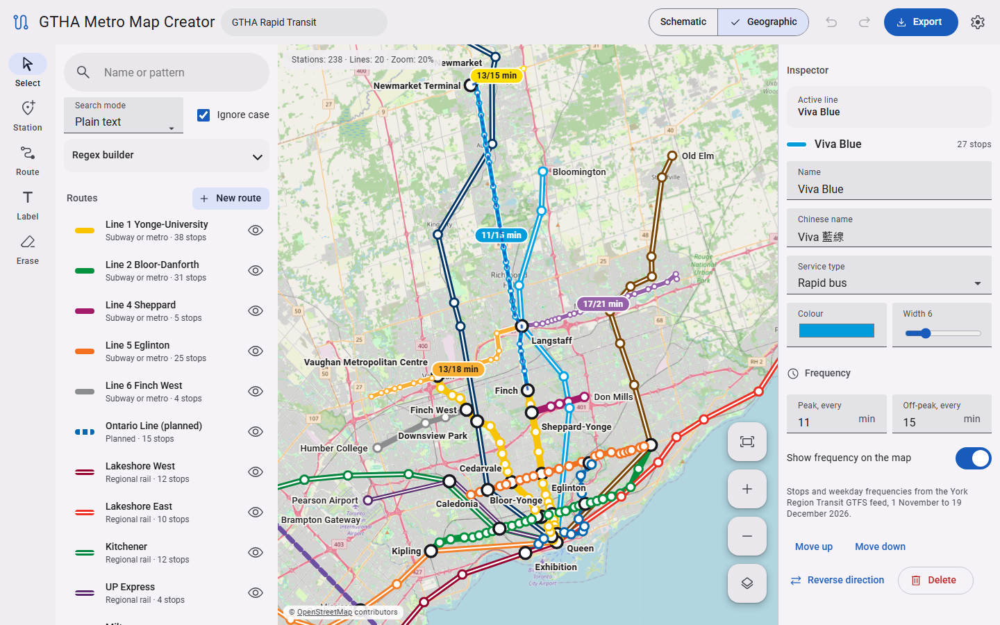
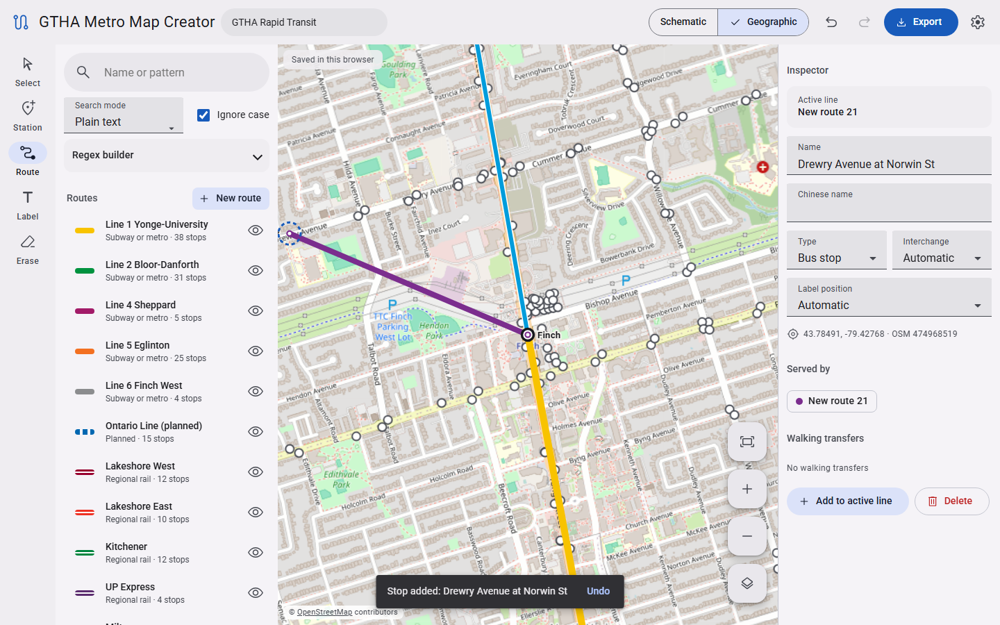
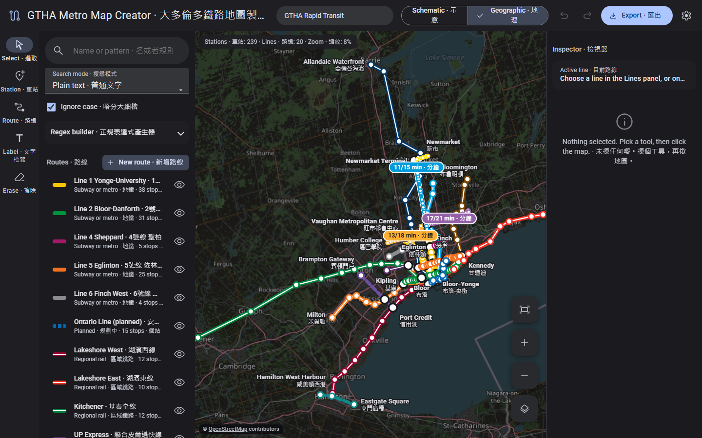

# GTHA Metro Map Creator

An editor for rapid transit, rail and bus maps of the Greater Toronto and Hamilton Area: draw on
OpenStreetMap or as a tidy schematic, give each route a frequency, and publish it as a PNG, a PDF
or a website. It runs in the browser with no dependencies and stores your work locally.

- **Editor:** https://ding-ding-projects.github.io/gtha-metro-map-creator/app/
- **Project site and guides:** https://ding-ding-projects.github.io/gtha-metro-map-creator/
- **Documentation:** https://ding-ding-projects.github.io/gtha-metro-map-creator/docs/
- **Desktop app and server setup wizard:** portable `.exe` files on the [releases page](https://github.com/Ding-Ding-Projects/gtha-metro-map-creator/releases)
- **Container image:** `ghcr.io/ding-ding-projects/gtha-metro-map-creator`

> Unofficial. The built-in template is a simplified schematic, not a TTC or Metrolinx product.
> Line colours are approximate and service status is not tracked.

## Screenshots

Captured from version 1.2.0 in headless Microsoft Edge at 1440 x 900, 15 November 2026.





Earlier captures are listed in [docs/screenshots/ARCHIVE.md](docs/screenshots/ARCHIVE.md).



## Features

- Geographic layout over OpenStreetMap (default) or a schematic with 45-degree bends; stations keep
  a position in both
- Draw onto real stops: zoom in, and stops and platforms from OpenStreetMap become clickable
- Service types: subway or metro, planned, regional rail, rapid bus, bus, express and super express
- Peak and off-peak frequency on every route, shown as badges on the map and in the legend
- Bus stops, interchanges and walking transfers
- VIVA Blue, Purple, Orange and Yellow with real stops and weekday frequencies from the York Region
  Transit timetable
- Export PNG, PDF, SVG and a single-file website to host; save and open whole projects
- Material Design 3 interface with motion, light and dark themes
- Express stop patterns, branches, frequencies for peak, midday, evening and weekend, and a
  frequent-network style (1.3)
- Station facility icons, scale bar and north arrow (1.3)
- Network timeline with opening years and a Play animation (1.3)
- Box select, copy and paste, Ctrl+K command palette, pinch zoom, colour-vision preview (1.3)
- Import routes, stops and frequencies from any GTFS feed, read on your computer (1.4)
- Trip planner and travel-time map on your own network (1.4)
- One-click auto-schematic from real positions (1.5)
- Map style presets and a print layout with vector PDF (1.5)
- Scenarios with swipe compare, change list and share links (1.6)
- Live service simulation with clip recording (1.6)
- GTFS feed export (1.6)
- Coverage from Statistics Canada 2021 population and an illustrative ridership estimate (1.6)
- Live TTC and YRT vehicles in the desktop app (1.6)

- Built-in GTHA template (238 stations and stops, 20 routes, real coordinates): TTC Lines 1, 2, 4, 5 and 6, the planned Ontario Line, GO Lakeshore
  West and East, Kitchener, Milton, Barrie, Richmond Hill, Stouffville, UP Express, and
  simplified Hurontario and Hamilton LRT lines, plus VIVA
- Octilinear routing: every segment bends at most once, at 45 degrees, diagonal first or
  straight first per segment
- Shared track: lines between the same pair of stops are offset side by side automatically
- Automatic label placement that avoids lines and neighbouring stops, with eight manual positions
- Tools: select and move, add station, draw line, text label, erase (erasing a middle segment
  splits a line); multi-select with align and nudge
- Insert a stop into a segment and every line using that segment picks it up
- Line styles: solid, dashed (planned) and regional rail with a centre stripe
- Station search in plain text or regular expression mode, with a regex builder: tokens, flags,
  plain-language explanation, highlighted test text, groups, replace preview and a pattern library
- Map check: unserved stations, short lines, duplicate names, stacked stations
- Undo and redo (200 steps), autosave in local storage
- Export SVG with title and legend, PNG at up to 2x, and JSON; import JSON by menu or drag and drop
- English, Cantonese and bilingual interface and station names; the template includes unofficial
  Traditional Chinese names for every station and line
- Light, dark and system themes; first-run setup wizard; optional sound effects; keyboard shortcuts
- Portable Windows desktop app: works offline, native open and save, recent maps
- Docker image, Compose file, `host.bat` (detached or interactive log view) and a portable server
  setup wizard that prints the address other devices on your network can open

## Run locally

```bash
node scripts/serve.mjs 8765 site
```

Then open http://127.0.0.1:8765/app/.

## Host on your network

Run `host.bat --detached` (needs Docker Desktop). It pulls the image, starts it, waits for the
health check and prints an address such as `http://192.168.1.20:8080/`. `host.bat --logs` adds a
status and log view; `host.bat --stop` stops it. Or run the server setup wizard from the releases.
See [docs/features/hosting.md](docs/features/hosting.md).

Each release also attaches a hosting bundle (`compose.yaml` and `host.bat` pinned to that version) and
appliance virtual machine images for Hyper-V, VirtualBox, VMware, Proxmox and QEMU that boot straight into
the server and show its address on the console. See [docs/features/appliance.md](docs/features/appliance.md).

## Build

- `build.bat` validates JavaScript syntax, template integrity and local links, then writes `dist/site`.
- `build-installer.bat` runs the build, packages `dist/gtha-metro-map-creator-site.zip`, and builds both
  portable executables into `dist/desktop-app/`, `dist/desktop-wizard/` and `dist/desktop-deploy/`.
- On other platforms: `node scripts/build.mjs`.

GitHub Actions deploys `dist/site` to GitHub Pages and publishes the container image on every push
to `main`. Pushing a `v*` tag builds the executables and publishes a release.

## Repository layout

| Path | Contents |
| --- | --- |
| `site/app/` | The editor: `app.js` (engine), `regex-builder.js`, `gtha-template.js`, `i18n.js`, `app.css` |
| `desktop/` | Desktop app (`app/`), server setup wizard (`wizard/`) and deploy app (`deploy/`) |
| `Dockerfile`, `docker/`, `compose.yaml`, `host.bat` | Container hosting |
| `appliance/` | Appliance virtual machine images |
| `site/index.html`, `site/docs/` | Project site and documentation |
| `design/` | Design canvas source for the editor, project site, desktop app and wizard |
| `docs/features/` | Feature documentation |
| `scripts/` | Build, local preview and executable verification scripts |

## Data

Station coordinates and map tiles: © OpenStreetMap contributors (ODbL). VIVA routes and frequencies:
York Region Transit open data. See `scripts/data/README.md`.

## Licence

MIT. See `LICENSE`.
