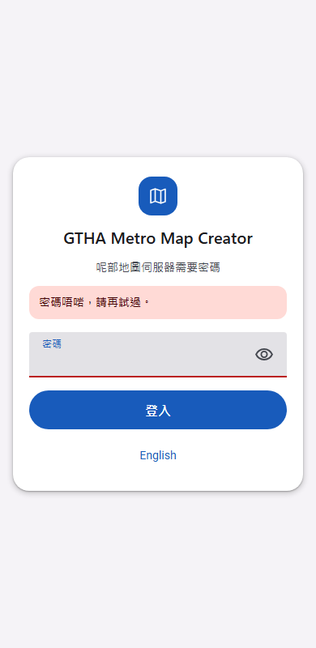

# Hosting with Docker

- `Dockerfile`: builds the site with Node, then serves `dist/site` from
  `nginxinc/nginx-unprivileged:1.27-alpine` on port 8080 as a non-root user. `/healthz` returns
  `ok`; the image has a `HEALTHCHECK`.
- `docker/nginx.conf`: security headers (`nosniff`, `no-referrer`, `SAMEORIGIN`), no server
  version, one-hour caching for scripts, styles and images.
- `compose.yaml`: uses the published image `ghcr.io/ding-ding-projects/gtha-metro-map-creator`,
  host port `GMMC_PORT` (default 8080), tag `GMMC_TAG` (default `latest`), read-only root file
  system with a `/tmp` tmpfs, restart unless stopped.
- `.github/workflows/image.yml`: on every push to `main` and on `v*` tags, builds and pushes
  `latest`, `sha-<short>` and the version tag to GitHub Container Registry. The package is public.

## host.bat

| Command | What it does |
| --- | --- |
| `host.bat` | Menu: detached, logs, stop or quit |
| `host.bat --detached` | Pull, start, wait up to 60 s for `/healthz`, print the local and network address, exit |
| `host.bat --logs` | The same, then a key menu: follow logs, last 50 lines, status, restart, stop, leave |
| `host.bat --stop` | `docker compose down` |
| `host.bat --password` | Asks twice for a password (hidden input), writes only its hash to `.env`, then starts as with `--detached`. Can be combined with `--detached` or `--logs` |
| `host.bat --no-password` | Removes the hash from `.env`. Run `host.bat --detached` afterwards to apply it |

Exit codes: 2 Docker missing, 3 Docker not running, 4 Compose v2 missing, 5 pull failed, 6 start
failed, 7 health check timed out, 8 the password could not be set, 1 unknown option.

## Release hosting bundle

Every release attaches `gtha-metro-map-creator-server-<version>.zip`. It holds `compose.yaml` and
`host.bat` pinned to that release's image tag (`GMMC_TAG` still overrides it) and a short
`README.txt` with the requirements, the `--detached` and `--logs` modes, how to change the port and
where the network address is shown. The release notes name the image tag and its digest. The bundle is
built by `scripts/make-server-bundle.mjs`.

## Appliance virtual machine

For a dedicated server without installing Docker yourself, each release also attaches disk images for
Hyper-V, VirtualBox, VMware, Proxmox and QEMU. See [appliance.md](appliance.md).

## Optional password sign-in

Sign-in is **off by default**. With no password configured the server behaves exactly as before: it
serves static files, stores nothing, and every visitor can open the editor and the documentation.

When it is on, every page except `/healthz` asks for a password first. A visitor without a session is
sent to `/signin`, a Material Design 3 page in English or Cantonese (chosen from the browser's
`Accept-Language`, with a link to switch), for light and dark themes and phones. After a correct password the visitor
returns to the page they asked for.




### Turn it on

| Where | How |
| --- | --- |
| `host.bat --password` | Hidden prompt, then `GMMC_PASSWORD_HASH` is written to `.env` next to `compose.yaml`. `.env` is git-ignored. `host.bat --no-password` turns it off |
| Server setup wizard | Step 2 has a **Require a password** switch and a password field. The wizard hashes it and starts Compose with only the hash |
| [Deploy app](deploy.md) | The Docker, SSH, VirtualBox, VMware and Raspberry Pi cards have the same switch and field. The hash is kept per instance (not for a Raspberry Pi card, which is written once) |
| [Appliance images](appliance.md#password-sign-in) | The hash is read at boot from a small disk labelled `GMMCCONF` or a `gmmc-password-hash` file on the Raspberry Pi boot partition and given to the same container |
| Compose or `docker run` by hand | Set `GMMC_PASSWORD_HASH` in the environment, or `GMMC_PASSWORD_HASH_FILE` to a mounted file (a Docker secret works) holding the hash on its first line |

The value is a hash, never the password: `pbkdf2-sha256:600000:<salt>:<hash>` (PBKDF2-HMAC-SHA256, 600,000
rounds, random 16-byte salt, base64url). To make one without `host.bat` or the desktop tools:

```bash
printf 'your password here' | docker run --rm -i ghcr.io/ding-ding-projects/gtha-metro-map-creator:latest gmmc-auth hash
```

The same works from Windows PowerShell (`'your password here' | docker run --rm -i ... gmmc-auth hash`). From 1.7.1
the command ignores the byte order mark that Windows PowerShell can put in front of piped text; with 1.7.0 that mark
became part of the hash and the password was then refused.

An invalid hash stops the container at start with a plain message (the value is never printed).
`GMMC_SESSION_HOURS` (1 to 720, default 12) sets how long a session lasts and `GMMC_COOKIE_SECURE=1` forces the
`Secure` flag (it is also set when a reverse proxy sends `X-Forwarded-Proto: https`).

### How it works

`docker/auth/` is a small service written with the Go standard library only (no third-party modules, one
static binary built in the Dockerfile). nginx asks it through `auth_request` whether a request carries a valid
session cookie, and it also serves the sign-in page. The entrypoint script `docker/entrypoint-auth.sh` chooses
the nginx configuration at start: `docker/auth-conf/off.*.conf` (nothing changes) or `on.*.conf`. If the
service cannot start, the container stops. If it stops later, every protected request fails closed.

- **Session cookie:** `gmmc_session`, an expiry plus an HMAC-SHA256 signature made with a random key created at
  start, so restarting the container signs everyone out. `HttpOnly`, `SameSite=Strict`, `Secure` over HTTPS.
  Sign out with `/signout`.
- **Rate limit:** nginx `limit_req` allows 6 posts a minute per client address to the sign-in form (bursts of up
  to 5 more), then redirects to the page with a "too many attempts" message. Each wrong password also waits 0.4 s.
  Behind a reverse proxy all visitors share the proxy's address, so the limit then applies to them together.
- **Open paths:** `/healthz` stays open for Docker health checks, the appliance boot test and the deploy
  app. `/signin`, its two assets and `/signout` are also open.
- **Nothing sensitive is logged:** the password arrives in a POST body, which nginx does not log, and the service
  logs only the words "sign-in attempt refused". The hash is not printed. It does sit in the container's
  environment (`docker inspect`), like any configuration value; it cannot be turned back into the password.
- **Limits:** sign-in protects against casual access on a network. It is a single shared password, not
  accounts. The server speaks plain HTTP, so on an untrusted network put it behind HTTPS, because a password
  and a session cookie sent over plain HTTP can be read by anyone on the path.

## Security

With sign-in off there is no authentication. The server only serves static files and stores nothing; maps
stay in each visitor's browser. Run it only on a network you trust and do not forward the port to the
internet. Turn sign-in on when other people share that network.
